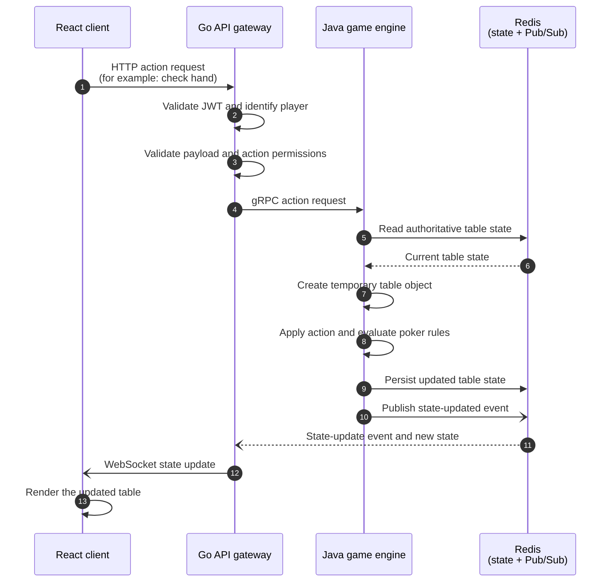

# Heads Up Masters v2

<p align="center">
  <strong>A real-time, competitive 1v1 poker platform built around deterministic game state.</strong>
</p>

<p align="center">
  <a href="#architecture">Architecture</a> ·
  <a href="#local-development">Local development</a> ·
  <a href="#deployment-design">Deployment design</a> ·
  <a href="#roadmap">Roadmap</a>
</p>


<br />


<sub><b>Gameplay</b></sub>

<br /><br />


<sub><b>Showdown</b></sub>

<br /><br />

> **Project status:** Heads Up Masters v2 is in active design and early
> development. The service boundaries and core protocols are established, and
> initial frontend, gateway, and game-engine code is present. The complete
> multiplayer flow, production infrastructure, bot service, and observability
> stack are still being implemented.

## Overview

Heads Up Masters v2 is a heads-up poker game: two players, one table, and a
shared authoritative game state. It is designed as a set of focused services
rather than a single application:

- The **React client** owns presentation and user interaction.
- The **Go gateway** owns the public API boundary, authentication,
  authorization, request validation, WebSockets, and service orchestration.
- The **Java game engine** owns poker rules and state transitions.
- **Redis** stores the authoritative state for active tables and distributes
  state-update events.

This separation keeps transport and identity concerns out of the game engine,
allows the engine to remain stateless between requests, and gives every
connected client the same source of truth.

## Architecture

### Service boundaries

| Component | Responsibility | Protocols |
| --- | --- | --- |
| **React client** | Lobby and table UI, player actions, live state rendering | HTTP, WebSocket |
| **Go API gateway** | JWT authentication/authorization, request validation, public API, WebSocket hub, backend bridge | HTTP REST, WebSocket, gRPC, Redis Pub/Sub |
| **Java game engine** | Poker rules and domain state transitions; request-scoped table objects | gRPC, Redis |
| **Redis** | Authoritative table state, lobby/session data, and state-update events | Redis data structures, Pub/Sub |
| **Python bot service** *(planned)* | Offline opponents and human-match fallback | Planned internal service API |

### Core request flow

The sequence below describes a representative action such as a player checking
their hand. The Java engine does not retain a table object after processing the
request; Redis is read before the transition and written after it.



### Why this design

- **Single source of truth:** clients do not calculate or persist game state.
- **Stateless engine:** game-engine instances can be scaled horizontally because
  table state lives in Redis, not in process memory.
- **Explicit contracts:** gateway-to-engine calls use Protocol Buffers and gRPC.
  The shared contract is maintained in
  [`GoServer/proto/table/v1/table.proto`](./GoServer/proto/table/v1/table.proto)
  and mirrored in the Java service under
  [`JavaServer/HeadsUpMastersV2/demo/src/main/proto/table/v1/table.proto`](./JavaServer/HeadsUpMastersV2/demo/src/main/proto/table/v1/table.proto).
- **Push-based updates:** Redis Pub/Sub and WebSockets avoid client polling for
  table changes.
- **Clear failure boundaries:** authentication, transport, game rules, and
  persistence can be tested and operated independently.

## Technology stack

### Frontend

- React 19
- TypeScript 6
- Vite
- Tailwind CSS and standard CSS
- Axios for HTTP integration
- `lucide-react` for interface icons

### Backend

- Go 1.26+ for the API gateway and WebSocket layer
- Java 21 target with Spring Boot 3.3.x for the game-engine service
- gRPC and Protocol Buffers for typed service-to-service calls
- JWT-based authentication at the gateway boundary

### Data and messaging

- Redis for table state, lobby data, sessions, and Pub/Sub
- `go-redis` in the gateway
- Jedis in the Java engine

### Delivery and operations

- GitHub Actions for service-level CI
- Docker for service images *(planned)*
- Kubernetes on Amazon EKS *(planned)*
- Amazon ECR for image storage *(planned)*
- OpenTelemetry, Prometheus, and Grafana *(planned)*

## Repository layout

```text
.
├── GoServer/
│   ├── cmd/api/client-server/       # Gateway process entry point
│   ├── internal/api/                # HTTP handlers and gateway routes
│   ├── internal/backend/            # gRPC client and engine bridge
│   ├── internal/cache/              # Redis clients and session/cache access
│   ├── internal/ws/                 # WebSocket hub and room management
│   ├── proto/table/v1/              # Protocol Buffers source and generated Go code
│   └── go.mod
├── JavaServer/
│   └── HeadsUpMastersV2/demo/
│       ├── src/main/java/           # gRPC server, rules, models, Redis repositories
│       ├── src/main/proto/          # Java-side Protocol Buffers source
│       ├── src/test/java/           # Java unit and application tests
│       └── pom.xml
├── ReactClient/
│   ├── src/api/                     # Client API integration
│   ├── src/components/              # Lobby, table, poker, and layout UI
│   ├── src/hooks/                   # Client-side state and health hooks
│   └── package.json
├── .github/workflows/               # Go and Java CI workflows
└── docker-compose.yml               # Reserved for local orchestration
```

## Local development

### Prerequisites

- Node.js and npm
- Go 1.26 or newer
- JDK 21
- Redis 7 or newer
- Git

The application is still being wired together, so service startup order,
environment variables, and ports may change while the contracts stabilize.

### Start Redis

Run Redis locally using your preferred installation, or use Docker:

```bash
docker run --name heads-up-redis -p 6379:6379 -d redis:7-alpine
```

### Start the React client

```bash
cd ReactClient
npm ci
npm run dev
```

Useful frontend commands:

```bash
npm run build
npm run lint
npm run preview
```

### Run the Go gateway

```bash
cd GoServer
go mod download
go test ./...
go run ./cmd/api/client-server
```

The gateway currently listens on `:8090` and exposes a basic `/health`
endpoint. Its runtime configuration is loaded from environment variables (or a
local `.env` file):

| Variable | Purpose |
| --- | --- |
| `FRONTEND_URL` | Allowed frontend origin |
| `JAVA_SERVER_URL` | Java gRPC engine address |
| `GO_GATEWAY_URL` | Gateway address used by local integrations |
| `REDIS_SERVER_URL` | Redis address, for example `localhost:6379` |
| `SECRET_JWT_KEY` | JWT signing secret; never commit this value |

### Run the Java engine

```bash
cd JavaServer/HeadsUpMastersV2/demo
./mvnw clean test
./mvnw spring-boot:run
```

On Windows, use `mvnw.cmd` instead of `./mvnw`. The Maven build generates
gRPC/Protocol Buffer sources from the table contract during `generate-sources`.

### CI

The repository currently has focused GitHub Actions workflows:

- [`go-gateway-ci.yml`](./.github/workflows/go-gateway-ci.yml) downloads Go
  dependencies and runs `go test -v ./...`.
- [`java-engine-ci.yml`](./.github/workflows/java-engine-ci.yml) runs Maven
  tests for the Java service.

The frontend has local `build` and `lint` scripts; frontend CI is planned as
part of the unified pipeline.

## Deployment design

Production deployment is planned for **AWS using Kubernetes on Amazon EKS**.
This is the target operating model, not a completed deployment.

### Proposed workload topology

| Workload | Kubernetes role | Exposure |
| --- | --- | --- |
| React client | Static web container served by a minimal web server | Public through an AWS Application Load Balancer |
| Go gateway | Deployment and Service; horizontally scalable | Public HTTP and WebSocket entry point |
| Java engine | Internal Deployment and ClusterIP Service | Private gRPC only |
| Python bot | Internal Deployment; scale independently from human games | Private service API *(planned)* |
| Redis | Managed Amazon ElastiCache for Redis preferred over an in-cluster database | Private subnets |

### Proposed delivery workflow

1. **Pull request validation** — Run frontend lint/build, Go tests, Java
   tests, protobuf compatibility checks, and container builds.
2. **Image publication** — On a protected `main` merge, build immutable
   images for the client, gateway, engine, and later the bot; tag them with
   the commit SHA and publish them to Amazon ECR.
3. **Infrastructure reconciliation** — Manage EKS, networking, ECR, Redis,
   IAM, and observability prerequisites with version-controlled IaC.
4. **Deployment promotion** — Apply Helm or Kustomize manifests to a
   development namespace, run smoke tests, then promote the same image digests
   to staging and production.
5. **Runtime verification** — Check HTTP, gRPC, Redis, and WebSocket health
   before marking a release successful; roll back to the previous image digest
   on failure.

### Production concerns to settle before launch

- Use AWS Secrets Manager or SSM Parameter Store for JWT and Redis credentials.
- Use TLS at the load balancer and authenticated, private gRPC between gateway
  and engine.
- Configure readiness/liveness probes for the gateway and engine.
- Use PodDisruptionBudgets, resource requests/limits, and horizontal autoscaling.
- Define Redis persistence, expiration, failover, and Pub/Sub delivery semantics.
- Add correlation IDs across HTTP, gRPC, Redis, and WebSocket messages.
- Add OpenTelemetry traces, Prometheus metrics, and Grafana dashboards.
- Add load, reconnect, duplicate-action, and failure-recovery tests before
  production traffic.

## Roadmap

### Active development

- [ ] Complete the React lobby, table, authentication, action, and live-state
      flows.
- [x] Finish the Go gateway's JWT validation, authorization, action validation,
      gRPC bridge, Redis subscriber, and WebSocket broadcast path.
- [x] Complete poker rules and request-scoped state transitions in the Java
      engine.
- [x ] Finalize Redis key schemas, event payloads, concurrency rules, and
      idempotency behavior.
- [ ] Add contract, integration, and end-to-end coverage for the core request
      flow.

### Planned

- [ ] Add a Python AI opponent for offline play and human-match fallback.
- [ ] Add Dockerfiles and local multi-service orchestration.
- [ ] Provision ECR, EKS, networking, managed Redis, IAM, and ingress.
- [ ] Deploy through a staged GitHub Actions workflow with rollback support.
- [ ] Add OpenTelemetry tracing across every service boundary.
- [ ] Add Prometheus metrics, Grafana dashboards, structured logs, and alerts.
- [ ] Establish production readiness gates for security, load, resilience, and
      disaster recovery.


